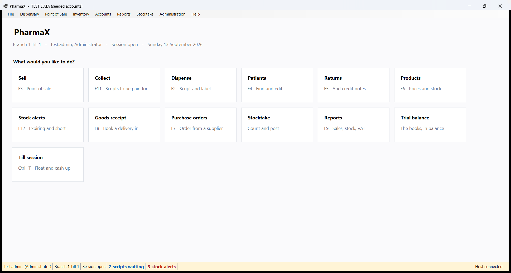
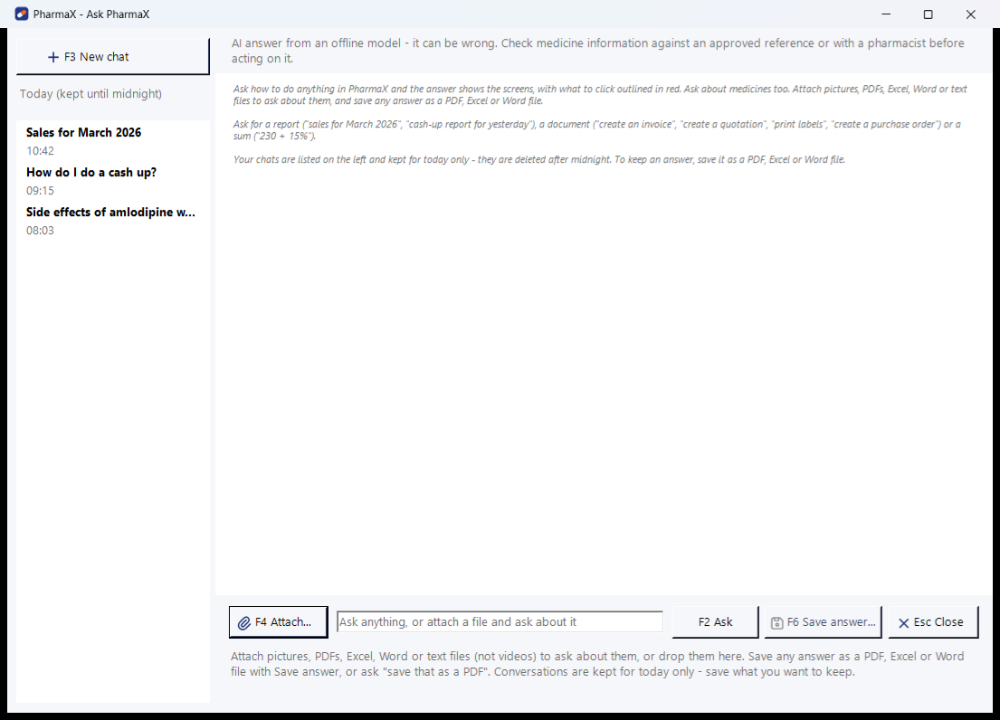
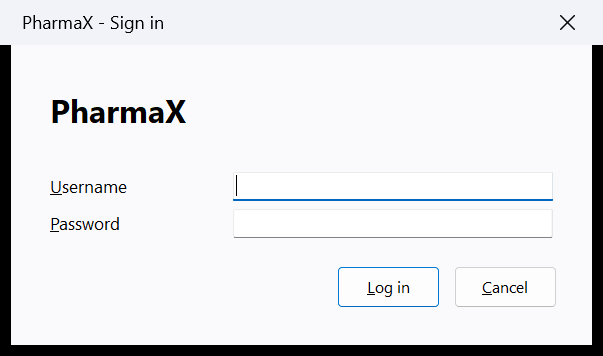
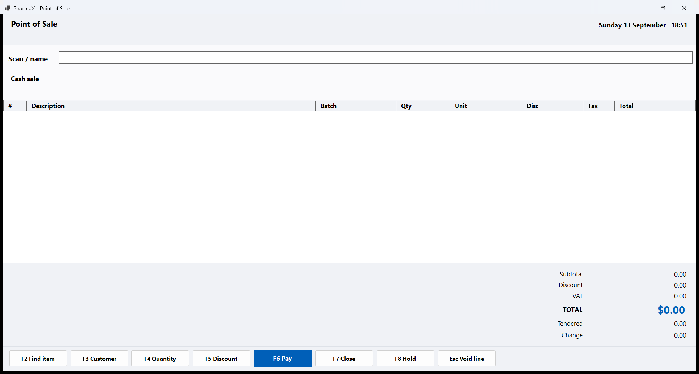
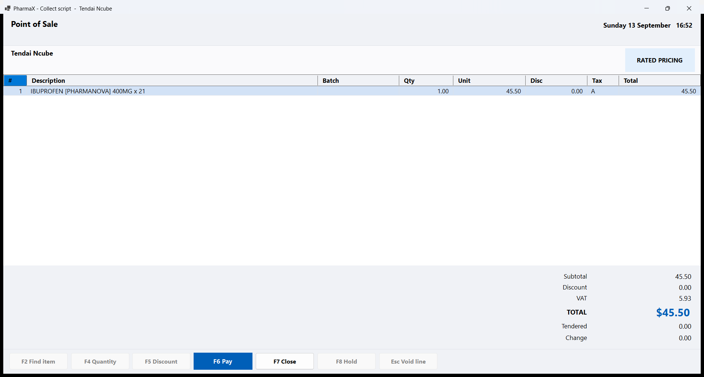
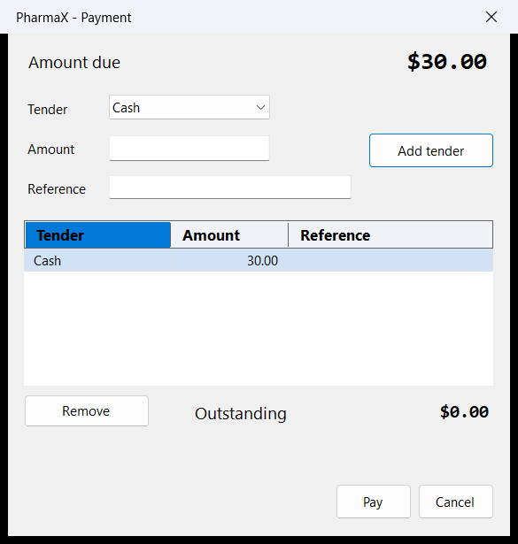
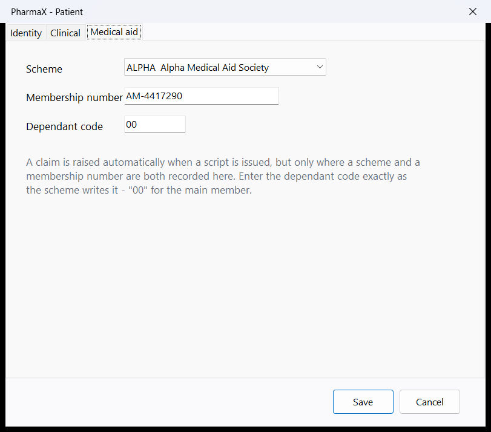
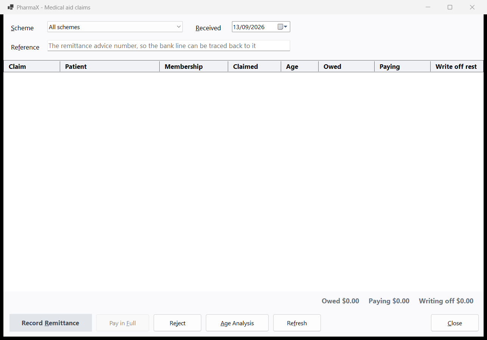
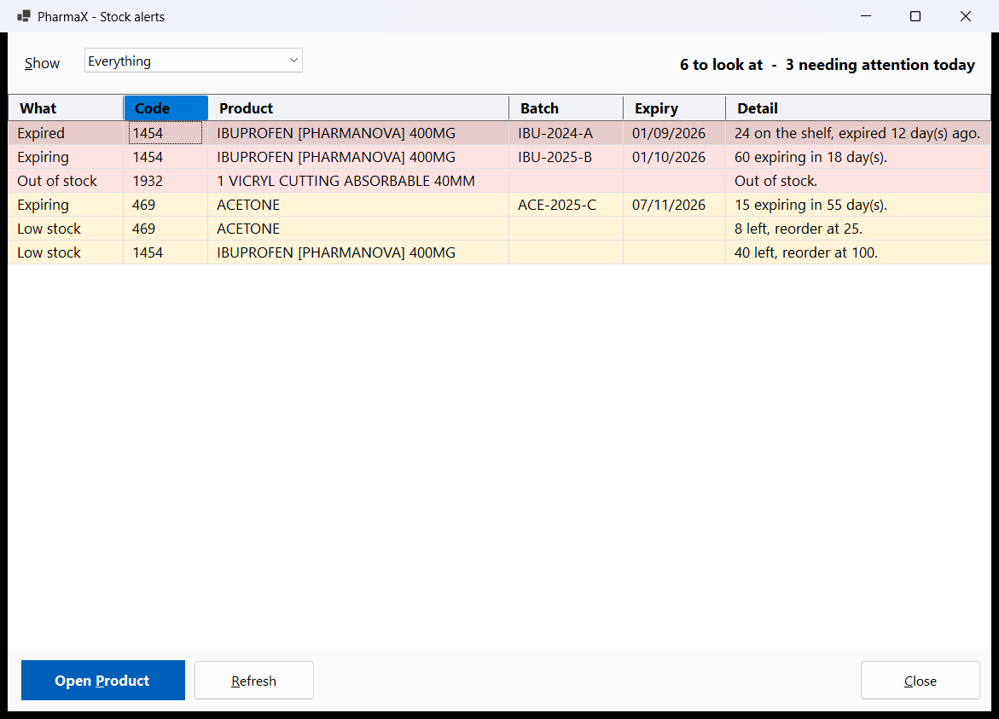
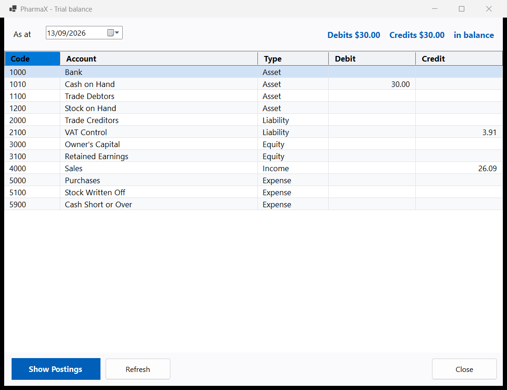

# PharmaX

**PharmaX** is a Windows desktop system for running a retail pharmacy: the till, the dispensary, stock, suppliers, debtors, the books and the reports. It is built for a pharmacy with one computer, or a main computer with several tills. Tills keep selling when the network goes down, and the built-in assistant, **Ask PharmaX**, runs offline on the pharmacy's own computer.



---

## Contents

- [Features](#features)
- [Ask PharmaX - the offline assistant](#ask-pharmax---the-offline-assistant)
- [Screenshots](#screenshots)
- [How it is built](#how-it-is-built)
- [Requirements](#requirements)
- [Getting started (developers)](#getting-started-developers)
- [Running the tests](#running-the-tests)
- [Building the installer](#building-the-installer)
- [Installing at a pharmacy](#installing-at-a-pharmacy)
- [Command-line options](#command-line-options)
- [Where PharmaX keeps things](#where-pharmax-keeps-things)
- [Documentation](#documentation)
- [Working on the code](#working-on-the-code)

---

## Features

Every screen opens from the home tiles, the menus or a function key (F2-F12). Each user sees only what their role allows. The roles are Administrator, Pharmacist, Pharmacist Assistant, Cashier, Stock Controller and Manager.

### Till and money
- **Point of sale.** Scan or search, quantities, discounts (above a limit, a supervisor must authorise), hold and recall, and a customer on the sale.
- **Payments.** Cash, card and account. Shows the change, and prints the receipt.
- **Till sessions.** Float, pay-outs and cash-up, with the expected and counted totals side by side.
- **Collect.** Dispensed scripts waiting at the till to be paid for.
- **Returns and credit notes.** Each must be authorised before it goes through.
- **Receipt template.** A layout editor for the pharmacy's own receipt.

### Dispensary and patients
- **Dispensing.** Script capture, dispensing, labels and authorisation, and reversals by a pharmacist.
- **Patients.** Search, edit, and medical aid membership.
- **Medical aid claims.** Rating and claims, plus the dispensary quote.
- **Label printers.** Chosen per dispensing PC.

### Stock and suppliers
- **Products.** Prices, stock on hand, batches and expiry.
- **Stock alerts.** Items that are expiring or running short.
- **Purchase orders and goods receipt.** Order from a supplier, then book the delivery in.
- **Transfers** between branches.
- **Stocktake.** Count, compare and post.

### Accounts
- **Debtors.** Account customers and statements.
- **The books.** A chart of accounts, journals and a trial balance. Trading can post to the ledger as it happens or in a day-end batch.

### Reports
- Sales, stock, VAT, cash-up and cost reports, with filters, charts and saved presets.
- Export to **PDF**, **Excel** and **CSV**.
- Ask for a report in plain words ("sales for March 2026").

### Administration
- Users, roles and permissions, branches, tills and workstations, pharmacy details, branding and currency.
- System information, logs and backups.
- Import from the pharmacy's previous system, with a check that every total matches.

---

## Ask PharmaX - the offline assistant



Ask PharmaX runs a small language model (Qwen3.5 2B, about 1.2 GB) **on the pharmacy's own computer**, in a separate process. No question or document leaves the machine.

- **How-to answers with screenshots.** Ask "how do I do a cash-up?" and the answer shows the real screens, with what to click outlined in red.
- **Reports.** Ask for one in plain words, such as "cash-up report for yesterday" or "sales for 2025". If no period is given, it asks which month or year. It then runs the report, shows the figures and a chart in the chat, and saves them to PDF or Excel.
- **Documents.** "Create an invoice", "create a purchase order", "print labels", "create a quotation", "create a receipt template" and similar requests either start a guided job, where the assistant fills in what it can and staff confirm the rest, or open the right screen.
- **Sums.** "230 + 15%", "12 x 45.50", "R1 200 ÷ 3".
- **Attachments.** Ask about pictures, PDFs, Excel, Word or text files. Text in pictures is read with Tesseract OCR, which the installer includes.
- **Save answer.** Saves to PDF, Excel or Word, then offers to open the file or show it in its folder.
- **Chat sidebar.** Today's chats are listed on the left with short titles, and each can be reopened (with its pictures) or deleted. Chats are encrypted per Windows user and **kept for today only**, then deleted after midnight. Anything worth keeping should be saved as a file.

> AI answers can be wrong. Check medicine information against an approved reference, or with a pharmacist, before acting on it.

---

## Screenshots

All screenshots use the test data and test accounts.

| Sign in | Point of sale |
|---|---|
|  |  |
| **Collect at the till** | **Payment** |
|  |  |
| **Patient and medical aid** | **Medical aid claims** |
|  |  |
| **Stock alerts** | **Trial balance** |
|  |  |

There are more in [`docs/screenshots`](docs/screenshots), and in the [user guide](docs/How-to-use-PharmaX.md).

---

## How it is built

PharmaX is a **.NET 8 Windows Forms** application. It uses a layered (clean) architecture, and its screens follow **Model-View-Presenter**.

```
PharmaX.sln
├── 1-Core
│   ├── PharmaX.Domain            Entities, value objects, roles and permissions - no dependencies
│   └── PharmaX.Application       Use cases, services, interfaces, assistant logic (sums, titles, guided jobs)
├── 2-Infrastructure
│   ├── PharmaX.Persistence       EF Core 8: SQLite on each till, MariaDB on the main computer, seeding, import
│   ├── PharmaX.Adapters          Printing (receipts, labels, claim forms), scanning and OCR, devices, files
│   ├── PharmaX.Reporting         Report definitions and runner, PDF / Excel / CSV / Word writers, charts
│   └── PharmaX.Sync              Connectivity monitor and outbox drainer (till ↔ main computer)
├── 3-Presentation
│   └── PharmaX.Desktop           WinForms shell, forms, presenters, first-run wizard, Program.cs
├── PharmaX.Assistant             Assistant client used by the desktop app
├── PharmaX.Assistant.Engine      Runs the language model (LLamaSharp) in its own process
└── 4-Tests
    ├── PharmaX.Tests.Unit         Unit, presenter and architecture (layer rule) tests
    └── PharmaX.Tests.Integration  Real container against a real SQLite file, migrated and seeded
```

### Key design points
- **Offline-first tills.** Each till writes to its own local SQLite database. Changes go into an outbox, which is sent to the main computer's MariaDB database once it can be reached. The status bar shows whether the host is connected.
- **Number blocks.** Receipt and document numbers are handed out in blocks, so a till that is offline never issues a duplicate.
- **MVP with enforced layers.** Presenters and view interfaces never reference WinForms types. Architecture tests (`LayerRuleTests`) fail the build if they do.
- **Permissions, not screens.** Every action checks a named permission (for example `pos.sale.take-payment` or `dsp.script.authorise`), and roles are bundles of permissions.

### Tech stack

| Area | Libraries |
|---|---|
| UI | Windows Forms (.NET 8, `net8.0-windows`) |
| Data | Entity Framework Core 8, SQLite, Pomelo MySQL provider (MariaDB 10.11), MySqlConnector |
| Documents | QuestPDF, ClosedXML, CsvHelper, PdfPig |
| OCR | Tesseract 5 |
| Assistant | LLamaSharp (CPU backend), Qwen3.5 2B GGUF model |
| Resilience and logging | Polly, Serilog |
| Tests | xUnit, FluentAssertions, NSubstitute |

The build uses C# 12, nullable reference types, code-style enforcement and the latest recommended analysers (`Directory.Build.props`). Package versions are managed centrally.

---

## Requirements

**To run PharmaX**
- Windows 10 or Windows 11 (64-bit)
- The Microsoft Visual C++ 2015-2022 runtime (the installer includes the DLLs PharmaX needs)
- For Ask PharmaX: about 1.3 GB of extra disk space for the model

**To build it**
- The [.NET 8 SDK](https://dotnet.microsoft.com/download/dotnet/8.0) or newer
- Visual Studio 2022, or any editor with the C# tooling
- [Inno Setup 6](https://jrsoftware.org/isinfo.php), only to build the installer

---

## Getting started (developers)

```powershell
git clone https://github.com/AdrianDrizzy/PharmaX.git
cd PharmaX
dotnet build PharmaX.sln
dotnet run --project PharmaX.Desktop
```

On first start, PharmaX runs the **first-run wizard**, which asks how this computer is used (see [Installing at a pharmacy](#installing-at-a-pharmacy)). For development, choose **one computer on its own**, which uses SQLite and needs no database server.

Settings live in `PharmaX.Desktop/appsettings.json`. To try PharmaX with demonstration data and test accounts, set `Development:SeedTestUsers` to `true` in a local `appsettings.Development.json`. That file must **never ship**, and the installer build refuses to package it.

To use Ask PharmaX while developing, download the model to the path in `Assistant:ModelPath`. The default is `%PROGRAMDATA%\PharmaX\assistant\Qwen3.5-2B-Q4_K_M.gguf`, and the download URL is in `installer/PharmaX.iss`. Without the model, the Ask box is simply unavailable.

---

## Running the tests

```powershell
# Unit, presenter and architecture tests
dotnet test PharmaX.Tests.Unit

# Integration tests (real EF Core container on a temporary SQLite file)
dotnet test PharmaX.Tests.Integration
```

The integration tests build the same container `Program.cs` builds, migrate and seed a real database, and catch what unit tests cannot, such as a mapping that compiles but will not save.

Tests that need the language model to be installed fail on a machine without it.

---

## Building the installer

`installer/build.ps1` builds the release:

```powershell
.\installer\build.ps1 -TradingName "Example Pharmacy" -Address "1 Main Road, Town" -SeedFrom "D:\Exports"
```

The script:
1. publishes a self-contained `win-x64` build to `dist\publish`;
2. copies the Visual C++ runtime DLLs and checks the Tesseract OCR files are present;
3. **refuses** to package developer settings, a real workstation ID or a shared connection string;
4. builds the starting database by running `PharmaX.Desktop.exe --import` against `-SeedFrom`;
5. downloads MariaDB 10.11 and checks its hash;
6. compiles `installer/PharmaX.iss` with Inno Setup 6 into `dist\PharmaX-Setup-<version>.exe`.

Useful switches:

| Switch | What it does |
|---|---|
| `-TestBuild` | A build for testing, with a known administrator sign-in |
| `-SkipInstaller` | Publishes only, without compiling the setup program |
| `-TradingName`, `-Address` | The pharmacy's details, printed on receipts and documents |

During setup, the installer offers to download the Ask PharmaX model (about 1.3 GB) and checks its SHA-256. If the download fails or is skipped, PharmaX works without the assistant.

---

## Installing at a pharmacy

Run `PharmaX-Setup-<version>.exe` on each computer. On first start, the wizard asks which kind of computer it is:

| Mode | Use it for | Database |
|---|---|---|
| **One computer on its own** | A small pharmacy with a single PC | SQLite on that PC |
| **The pharmacy's main computer** | The server for a pharmacy with several tills | MariaDB, which setup installs and configures |
| **A till** | Every other PC | Local SQLite, kept in step with the main computer |

- Set up the **main computer first**, then the tills. Every till needs its own till number.
- Choose the **label printer** on every PC that dispenses.
- Tills connect to the main computer on port **3306**, which must be open in the main computer's firewall.
- On the main computer, the installer schedules a **nightly backup**.

[`installer/readme-after-install.txt`](installer/readme-after-install.txt) has the full checklist.

---

## Command-line options

`PharmaX.Desktop.exe` also runs a few jobs without opening a window. Each needs a computer that has already been set up.

| Command | What it does |
|---|---|
| `--import "D:\Exports" [more] [--dry-run]` | Loads data exported from the previous system, saves a report beside the logs, and exits non-zero if any total does not agree |
| `--backup` | Backs up the database (used by the nightly scheduled task) |
| `--reset-admin` | Puts the `admin` sign-in back to its starting password, for when it is lost |
| `--clear-waiting` | Run by the installer on an upgrade |
| `--setup-server <msi>` | Run by the installer on the main computer to set up MariaDB |

---

## Where PharmaX keeps things

Everything is under `C:\ProgramData\PharmaX`:

| Path | Contents |
|---|---|
| `workstation.json` | This computer's identity, mode, branch and till number |
| `data\pharmax.db` | The local SQLite database |
| `logs\` | Log files (the last 30 are kept) |
| `attachments\` | Attached files |
| `branding\` | The pharmacy's logo |
| `assistant\` | The Ask PharmaX model and its cache |
| `server.json`, `database-admin.txt` | Main computer only: the database server's details |

Ask PharmaX chats are kept separately for each Windows user, under `%LocalAppData%\PharmaX\Assistant`. They are encrypted with Windows Data Protection and deleted after the day they were written.

---

## Documentation

- [**How to use PharmaX**](docs/How-to-use-PharmaX.md) is the user guide, with screenshots. It covers getting around, a working day, the till, the dispensary, stock, stocktake, accounts, reports, administration and Ask PharmaX.
- [`installer/readme-after-install.txt`](installer/readme-after-install.txt) is the first-run and set-up checklist.

---

## Working on the code

- **Follow the layers.** Domain has no dependencies. Application depends only on Domain. Infrastructure implements Application's interfaces. The desktop app wires everything together in `DependencyInjection.cs`.
- **Keep presenters free of WinForms.** Put UI work behind the view interface. `LayerRuleTests` will tell you if something slips through.
- **Function keys are assigned automatically** to a screen's buttons. Do not hard-code them.
- **Test what you add.** Use a presenter test with a substituted view for screen logic, and an integration test for anything that touches the database.
- **Never commit** `appsettings.Development.json`, real connection strings, or the large demo recordings under `evidence/` (they are git-ignored).

Branches are merged to `main` through pull requests.
